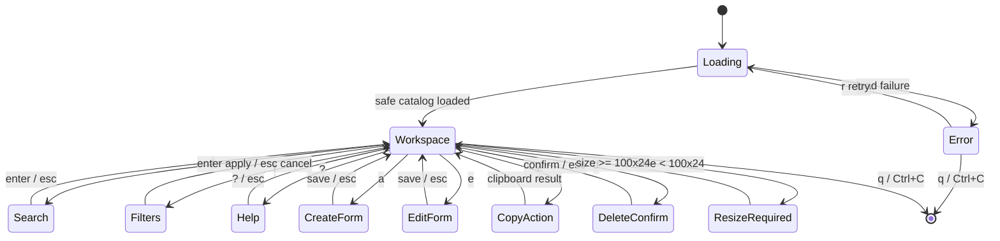

# UI Specification: Wide-Screen Secret Workspace TUI

**Status:** Revised draft — awaiting user review before implementation.

## Product Target

`shelf tui` is an optional, full-screen, keyboard-first workspace for one personal vault. It provides a safe item catalog and the interactive equivalents of the core item-oriented CLI workflows:

- browse, search, and filter item metadata;
- create an item;
- update item identity, labels, aliases, and fields;
- copy a selected field to the system clipboard;
- delete an item after confirmation.

The TUI is not a lower-security path. It invokes the same application workflows and validation as the CLI; the difference is high-bandwidth selection, masked form input, and a persistent workspace layout.

### CLI Functions That Stay CLI-First

The following are intentionally not TUI actions because their primary contract is machine output or child-process execution:

- `secret get` and `secret export` write values to stdout;
- `project export` and `project run` materialize values for an external consumer;
- `setup`, `doctor`, and `completion` are one-shot system commands.

Project binding management receives its own TUI phase after the secret workspace is stable.

### Scope Fences

- No secret reveal view and no secret text in a catalog/detail/error/help screen.
- No `.env` editor, named runtime environments, daemon, Web UI, or custom-template authoring.
- No automatic shell loading.

## Entry, Terminal Contract, and Lifecycle

```text
shelf tui
  ├─ stdin or stdout is not a TTY → CLI error: requires an interactive terminal
  ├─ terminal is smaller than 100×24 → resize screen; no narrow fallback
  ├─ valid wide TTY → alternate-screen workspace
  ├─ q / Ctrl+C → restore terminal and exit
  └─ load error → safe error screen with Retry or Quit
```

This phase intentionally optimizes a normal desktop terminal. A narrow layout is not implemented or silently degraded; the resize screen is explicit.

```text
Shelf TUI needs a terminal at least 100 columns × 24 rows.
Current size: 82 × 23

Resize the terminal, then press r.  q quit
```

The CLI performs TTY preflight. The TUI loads catalog data asynchronously through a Bubble Tea command. `r` retries an error or reloads catalog data.

## Workspace Layout

```text
Shelf  ·  Catalog                           12 items  ·  template: All  ·  labels: All
┌─ Catalog (36%) ──────────────────────────┬─ Detail / Editor (64%) ──────────────────────────┐
│ › OpenAI personal  api_credential  set   │ OpenAI personal                                    │
│   GitHub work      generic_secret  set   │ id:       item_openai                              │
│   Database local   generic_secret  unset │ template: api_credential                            │
│                                          │ labels:   ai, personal                              │
│ / search  f filters                    │ aliases:  openai, llm                               │
│                                          │                                                     │
│                                          │ fields                                              │
│                                          │ › credential      secret · set                      │
│                                          │   credential_env  OPENAI_API_KEY                    │
│                                          │   provider        OpenAI                            │
│                                          │   website         https://…                         │
│                                          │   expires_at      2026-12-31                        │
└──────────────────────────────────────────┴─────────────────────────────────────────────────────┘
Tab pane  a add  e edit  c copy  d delete  / search  f filters  r reload  ? help  q quit
```

- Left catalog: approximately 36% of width, with a minimum of 34 columns.
- Right workspace: approximately 64%, switching among detail, form, confirmation, help, and safe error states.
- The selected row and active pane use a cursor/focus border plus text, never color alone.
- The item list always remains visible behind an editor or confirmation state, giving a persistent lazygit-like sense of context.

## Screen and Action Model



### Browse, Search, and Filters

- `/` focuses a text query. It is case-insensitive substring matching across title, ID, template, labels, and aliases only.
- `f` opens a compact right-pane filter sheet:
  - one template: All or a concrete template;
  - zero or more labels; all selected labels must match, consistent with label export semantics;
  - `enter` applies, `esc` cancels, `c` clears.
- The header always reports active filters and result count.
- No field values participate in searching or filtering.

### Detail and Field Selection

`Tab` switches focus between catalog and the detail field list. In the detail pane, `j`/`k` selects a field.

| Field kind | Rendered content |
| --- | --- |
| Secret | field ID, type, `secret`, and `set` or `unset` only |
| Public, set | field ID and public value |
| Public, unset | field ID and `unset` |

Selecting a field controls `e` and `c`. The default field is the template primary secret field when no field is selected.

### Create

`a` replaces the right pane with a multi-step form:

1. choose built-in template or profile;
2. enter item identity: title, optional stable ID, labels, aliases;
3. enter supported public metadata;
4. enter the primary secret field with masked input;
5. review a value-free summary and save or cancel.

The form calls `app.CreateSecret`; no direct vault mutation occurs. Secret form input is masked and is not rendered after save or cancellation.

### Edit

`e` opens a right-pane form for the selected item or field:

- item focus: title, labels, aliases;
- public field: typed public input or explicit clear;
- secret field: masked replacement input only; there is no prefilled value and no reveal operation.

The form calls `app.UpdateSecret`. A save returns to refreshed safe detail. `esc` discards all unsaved form changes.

### Copy

`c` explicitly copies the selected field through the existing clipboard adapter. It briefly shows one value-free outcome:

```text
Copied credential to clipboard.
```

The copied string is never rendered or stored in the Bubble Tea model. Clipboard failures are value-free and leave the detail view active.

### Delete

`d` opens an inline confirmation showing title, ID, and template only:

```text
Remove “OpenAI personal”?
This removes the local item and cannot be undone by Shelf.

enter confirm   esc cancel
```

Confirmation calls the existing remove workflow. The catalog reloads after success.

## Keymap

| Context | Keys | Behavior |
| --- | --- | --- |
| Catalog or detail field list | `↑`/`k`, `↓`/`j` | Move selection in active pane |
| Workspace | `Tab`, `h`/`l` | Switch active pane |
| Workspace | `/` | Search |
| Workspace | `f` | Filters |
| Workspace | `a` | Create item |
| Workspace | `e` | Edit selected item or field |
| Workspace | `c` | Copy selected/default field |
| Workspace | `d` | Delete selected item after confirmation |
| Workspace | `r` | Reload catalog |
| Any | `?` | Toggle full keyboard help |
| Form / filter / confirmation / help | `esc` | Cancel or return to workspace |
| Any | `q`, `Ctrl+C` | Quit and restore terminal |

No key writes, copies, deletes, exports, or runs a command without explicit user action.

## Safety Contract

### Renderable Data

- Catalog: ID, title, template, primary env name, labels, aliases, primary `value_set`.
- Detail: safe public field values and secret-field `value_set` metadata.
- Form state: public drafts and labels/aliases; masked secret draft only while the active form needs it.
- UI state: screen, selection, query, filters, dimensions, and value-free error/status text.

### Never Rendered

- `vaultmodel.Field.Value` for any secret field.
- `GetSecretField` output, export output, or project-resolved values.
- Secret text in list delegates, filter values, detail, confirmation, help, error, logs, or test snapshots.

### Controlled Materialization

- Copy materializes a secret only in a short-lived action local, then passes it to `internal/clipboard`; it never enters model state or a rendered string.
- Create/edit secret drafts are held only by the active masked form. Save/cancel drops the form model. Go cannot promise complete memory zeroization, so the design promises short lifetime, no logging, and no rendering—not impossible memory erasure.
- The TUI uses existing app validation and repository writes; it never reads or writes vault JSON directly.

## Visual System

- Text-first, restrained Lip Gloss styling; borders only delineate the persistent catalog and right workspace.
- Adaptive light/dark styles from the terminal background-color message.
- Status is always expressed with text (`set`, `unset`, `secret`, `public`) plus focus indicators, not color alone.
- Avoid decorative panels, gauges, or wide empty gutters; the right pane prioritizes field context and forms.

## Technical Contract

### Stack

| Layer | Choice | Reason |
| --- | --- | --- |
| Program model/lifecycle | `charm.land/bubbletea/v2` | Model–Update–View state machine, full-screen terminal handling, resize/key messages, deterministic model tests |
| Catalog / filtering | `charm.land/bubbles/v2/list`, `textinput` | Keyboard list and text filter without custom cursor/filter machinery |
| Detail scrolling | `charm.land/bubbles/v2/viewport` | Long detail and form content inside the right pane |
| Key help | `charm.land/bubbles/v2/help`, `key` | Discoverable short/full keyboard help |
| Forms | `github.com/charmbracelet/huh/v2` | Composable Bubble Tea forms, validation, and masked secret input |
| Styling | existing `charm.land/lipgloss/v2` | Adaptive terminal styling and existing project convention |

### Package Boundaries

```text
cmd/shelf -> cli
cli       -> app, tui, cliui, Cobra, x/term
tui       -> app, clipboard, Bubble Tea, Bubbles, Huh, Lip Gloss
```

`internal/tui` is an adapter. It owns terminal state/rendering and calls app workflows plus the existing clipboard boundary. It performs no direct vault, project-manifest, config, or resolver I/O.

### Safe Catalog Data

The app provides a safe catalog query, conceptually:

```go
type SecretCatalogItem struct {
    ID, Title, Template, Env string
    Labels, Aliases           []string
    ValueSet                  bool
}
```

The catalog loads once and filters in TUI memory. Selected details use existing safe item info. Action forms call `CreateSecret`, `UpdateSecret`, or remove workflows; copy uses a short-lived materialization local only.

## Test Strategy

- App tests: safe catalog DTO contains labels/aliases but no secret values; existing workflows preserve atomic validation.
- TUI model tests: loading, empty, error/retry, search, AND-label filter, template filter, pane focus, field selection, resize-required state, forms, cancellation, delete confirmation, and key help.
- Safety tests: fake secret values must be absent from every catalog/detail/filter/help/error/confirmation view; masked input must not echo.
- Action tests: create/update/delete call app workflows; copy invokes the clipboard writer with no value-bearing rendered status.
- CLI tests: `shelf tui` rejects non-TTY streams before a program starts.
- Manual smoke: launch in a wide real terminal; verify alternate-screen cleanup, resize-required behavior, browse, create, edit, copy, delete, filter, and `q` restoration.

## Implementation Sequence

1. Add safe app catalog query and its tests.
2. Add `internal/tui` workspace model, styles, keymap, wide layout, catalog/detail, and safety tests.
3. Add create/edit/copy/delete forms/actions against existing app and clipboard boundaries.
4. Add `shelf tui` Cobra command, TTY preflight, dependencies, architecture-lint rules, full verification, and manual terminal smoke.

## Review Gate

Do not implement until the user approves this revised wide-screen workspace contract.

## Sources

- Bubble Tea v2: https://github.com/charmbracelet/bubbletea
- Bubble Tea package docs: https://pkg.go.dev/charm.land/bubbletea/v2
- Bubbles v2 list/help/viewport: https://github.com/charmbracelet/bubbles
- Huh v2: https://github.com/charmbracelet/huh
- Lip Gloss v2: https://github.com/charmbracelet/lipgloss
