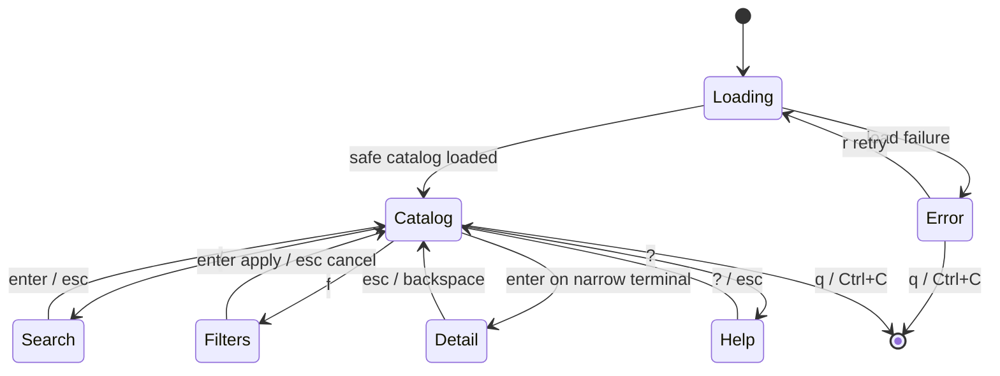

# UI Specification: Safe Catalog TUI

**Status:** Draft — awaiting user review before implementation.

## Product Slice

`shelf tui` is an optional full-screen, keyboard-first catalog for a single personal vault. It helps a developer find and understand an item without opening JSON or materializing a secret value.

It is deliberately read-only in Phase 48. Creation, editing, copy, deletion, and project binding are later phases. Existing CLI commands stay scriptable and authoritative.

### User Job

> Find the right structured secret item quickly; inspect its safe context; then choose the explicit CLI action that intentionally materializes or changes a value.

### Scope Fences

- No secret reveal, copy, write, or project-manifest mutation.
- No `.env` editor, named runtime environments, daemon, Web UI, or custom-template authoring.
- No automatic loading into the current shell.

## Entry and Lifecycle

```text
shelf tui
  ├─ non-interactive stdin or stdout → CLI error: requires an interactive terminal
  ├─ valid TTY → alternate-screen TUI
  ├─ q / Ctrl+C → restore terminal and exit
  └─ startup/load error → safe error screen with Retry or Quit
```

The CLI performs TTY preflight. TUI loading is asynchronous through a Bubble Tea command so the first screen can render immediately. `r` retries an error or reloads the catalog.

## Screen Model



### Loading

```text
Shelf  ·  Catalog

Loading local vault…
```

No item data is rendered until safe catalog data is available.

### Empty Catalog

```text
Shelf  ·  Catalog

No secrets found.
Create one with:
  shelf secret create <title> --stdin

q quit   r reload
```

### Catalog — Wide Terminal

At width >= 100 columns and height >= 18 rows, show a two-pane layout.

```text
Shelf  ·  Catalog                         12 items  ·  template: All  ·  labels: All
────────────────────────────────────────────────────────────────────────────────────────────
› OpenAI personal          api_credential  set      OpenAI personal
  GitHub work              generic_secret  set      work, source-control    OpenAI personal
  Database local           generic_secret  unset    local                   id: item_openai
                                                                         template: api_credential
                                                                         labels: ai, personal
                                                                         aliases: openai, llm
                                                                         fields
                                                                           credential      secret · set
                                                                           credential_env  OPENAI_API_KEY
                                                                           provider        OpenAI
                                                                           website         https://…
                                                                           expires_at      2026-12-31
────────────────────────────────────────────────────────────────────────────────────────────
↑/↓ move  / search  f filters  r reload  ? help  q quit
```

The list consumes about 40% of width. The detail pane has the remaining width. Terminal width never causes values to be elided into a secret-bearing representation because secret values are never present in the view model.

### Catalog — Narrow Terminal

At width < 100 or height < 18, show the catalog list only. `enter` opens a full-screen detail view; `esc` or `backspace` returns to the list.

At width < 60 or height < 14, show only:

```text
Terminal too small (minimum 60×14).
Resize the terminal, then press r.  q quit
```

### Search and Filters

- `/` focuses a text query. Search is case-insensitive substring matching over title, ID, template, labels, and aliases only.
- `f` opens a compact filter sheet:
  - one template: All or a concrete template;
  - zero or more labels; all selected labels must match, consistent with label export semantics;
  - `enter` applies, `esc` cancels, `c` clears.
- The header always shows active filters and result count.
- Search/filter results remain catalog metadata only.

### Detail

Detail displays item identity, labels, aliases, and fields in template order:

| Field kind | Rendered content |
| --- | --- |
| Secret | field ID, type, `secret`, and `set` or `unset` only |
| Public, set | field ID and public value |
| Public, unset | field ID and `unset` |

The detail screen never calls `GetSecretField`, export, project resolution, or clipboard operations.

### Help

`?` opens full keyboard help. Every interaction has a keyboard path; color is never the only status signal.

## Keymap

| Context | Keys | Behavior |
| --- | --- | --- |
| Catalog | `↑`/`k`, `↓`/`j` | Move selection |
| Catalog | `enter` | Open detail on narrow layout; focus detail on wide layout |
| Catalog | `/` | Search |
| Catalog | `f` | Filters |
| Catalog | `r` | Reload catalog |
| Any | `?` | Toggle help |
| Detail / Help / Search / Filters | `esc` | Return to previous screen or cancel transient state |
| Any | `q`, `Ctrl+C` | Quit and restore terminal |

There are no write, reveal, copy, or run keys in Phase 48.

## Safety Contract

### Allowed Data in TUI State

- `SecretItemSummary`: ID, title, template, primary env name, primary `value_set`.
- Catalog-only additions: labels and aliases.
- `SecretInfo`: safe public field values and secret field `value_set` metadata.
- Current screen, selection index, query, filters, dimensions, and safe error text.

### Forbidden

- `vaultmodel.Field.Value` for any secret field.
- Outputs of `GetSecretField`, `ExportSecretItems`, `ProjectExport`, or project resolution.
- Secret text in list delegates, filter values, detail content, errors, logs, test snapshots, or clipboard state.

A new app-level safe catalog query must supply labels and aliases without giving `internal/tui` direct access to a vault, JSON repository, config, or resolver.

## Visual System

- Inherit the project’s restrained Lip Gloss treatment: text-first, no decorative panels unless they separate input from detail.
- Use the terminal background-color message to choose light/dark adaptive styles.
- Use semantic text (`set`, `unset`, `secret`, `public`), cursor position, and focus styles; do not rely only on color.
- Avoid a dense grid: catalog rows are scannable, detail is vertically ordered, and help is compact by default.

## Technical Contract

### Stack

| Layer | Choice | Reason |
| --- | --- | --- |
| Program model/lifecycle | `charm.land/bubbletea/v2` | Model–Update–View state machine, full-screen terminal handling, resize/key messages, deterministic model tests |
| Catalog / filter input | `charm.land/bubbles/v2/list`, `textinput` | Keyboard list and filter input without custom cursor/filter machinery |
| Detail scrolling | `charm.land/bubbles/v2/viewport` | Safe long detail rendering and resize-aware scrolling |
| Key help | `charm.land/bubbles/v2/help`, `key` | Discoverable short/full keyboard help |
| Styling | existing `charm.land/lipgloss/v2` | Existing dependency and adaptive terminal styling |
| Forms | none in Phase 48 | `huh/v2` enters only in Phase 49 editing flows |

### Package Boundaries

```text
cmd/shelf -> cli
cli       -> app, tui, cliui, Cobra, x/term
internal/tui -> app, Bubble Tea, Bubbles, Lip Gloss
```

`internal/tui` is an adapter. It calls app-level safe query methods, owns terminal state/rendering, and performs no vault or manifest I/O itself.

### App Data Shape

Phase 48 adds a safe catalog DTO/query, conceptually:

```go
type SecretCatalogItem struct {
    ID, Title, Template, Env string
    Labels, Aliases           []string
    ValueSet                  bool
}
```

It is loaded once at startup, filtered in TUI memory, and reloaded only on `r`. Selecting an item loads `SecretInfo` on demand for safe detail data.

### Test Strategy

- App tests: catalog DTO includes labels/aliases and never secret values.
- TUI model tests: loading, empty, error/retry, search, AND-label filter, template filter, selection, narrow-detail navigation, resize threshold, and key help.
- Security tests: fake secret input must be absent from every catalog/detail/filter/help/error view exercised by tests.
- CLI tests: `shelf tui` rejects non-TTY streams before a program starts.
- Manual smoke: launch in a real terminal; verify alternate-screen cleanup, resize, search, filter, and `q` restoration.

## Implementation Order

1. Add safe app catalog DTO/query plus app tests.
2. Add `internal/tui` pure model, styles, keymap, list/detail screens, and model tests.
3. Add `shelf tui` Cobra command with TTY preflight and architecture-lint dependencies.
4. Run full verification and manual terminal smoke.

## Review Gate

Do not implement Phase 48 until this interaction model and safety contract are approved by the user.

## Sources

- Bubble Tea v2: https://github.com/charmbracelet/bubbletea
- Bubble Tea package docs: https://pkg.go.dev/charm.land/bubbletea/v2
- Bubbles v2 list/help/viewport: https://github.com/charmbracelet/bubbles
- Lip Gloss v2: https://github.com/charmbracelet/lipgloss
